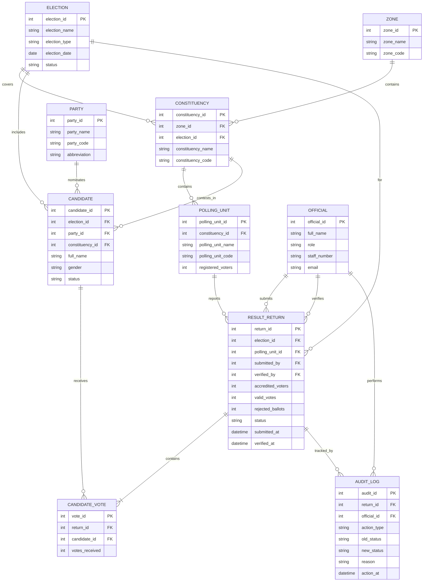

# NERMS Entity-Relationship Diagram

**Project:** National Election Results Management System (NERMS)  
**Student:** Ismail Muhammed (`301904296`)  
**Portfolio:** 1 – Database Design and Modelling  

---

## 1. ER Diagram

---

## 2. Entity Descriptions

| Entity | Description |
|--------|-------------|
| **ELECTION** | A defined electoral contest (e.g. presidential, senatorial) with type, date, and lifecycle status. |
| **ZONE** | Higher-level geographic area such as a state or region. |
| **CONSTITUENCY** | Electoral district within a zone for a given election. |
| **POLLING_UNIT** | Smallest reporting location where votes are counted and a return is produced. |
| **PARTY** | Registered political party that nominates candidates. |
| **CANDIDATE** | Person contesting an election in a constituency under a party. |
| **OFFICIAL** | Electoral staff member who submits, verifies, or amends result returns. |
| **RESULT_RETURN** | One polling-unit result submission: turnout figures, vote totals, and processing status. |
| **CANDIDATE_VOTE** | Votes awarded to each candidate on a specific result return. |
| **AUDIT_LOG** | Trace of status changes and corrections applied to result returns. |

---

## 3. Relationship Summary

| Relationship | Cardinality | Meaning |
|--------------|-------------|---------|
| ZONE → CONSTITUENCY | 1 : N | A zone contains many constituencies. |
| ELECTION → CONSTITUENCY | 1 : N | An election is organised across many constituencies. |
| CONSTITUENCY → POLLING_UNIT | 1 : N | A constituency contains many polling units. |
| ELECTION → CANDIDATE | 1 : N | An election has many candidates. |
| PARTY → CANDIDATE | 1 : N | A party nominates many candidates. |
| CONSTITUENCY → CANDIDATE | 1 : N | Many candidates contest in one constituency. |
| POLLING_UNIT → RESULT_RETURN | 1 : N | A polling unit may have multiple return versions over time (e.g. original then corrected). |
| ELECTION → RESULT_RETURN | 1 : N | An election receives many polling-unit returns. |
| OFFICIAL → RESULT_RETURN (submit) | 1 : N | An official may submit many returns. |
| OFFICIAL → RESULT_RETURN (verify) | 1 : N | An official may verify many returns. |
| RESULT_RETURN → CANDIDATE_VOTE | 1 : N | Each return lists votes for multiple candidates. |
| CANDIDATE → CANDIDATE_VOTE | 1 : N | A candidate appears on many returns across polling units. |
| RESULT_RETURN → AUDIT_LOG | 1 : N | Each return can have many audit events. |
| OFFICIAL → AUDIT_LOG | 1 : N | An official may perform many audited actions. |

---

## 4. Key Design Notes

- **RESULT_RETURN** is the transactional heart of NERMS: one submission header per polling-unit report, with candidate totals stored separately in **CANDIDATE_VOTE**.
- Separating **CANDIDATE_VOTE** from **RESULT_RETURN** avoids repeating candidate lists inside a wide return table and keeps per-candidate totals easy to aggregate.
- **AUDIT_LOG** supports controlled corrections without silently overwriting history.
- A candidate is uniquely tied to one election, one party, and one constituency for this model (one candidacy row per contest placement).

---

## 5. Next Step

Implement the relational schema in SQL (`Ismail_Muhammed_301904296_Relational_Schema.sql`) with primary keys, foreign keys, and integrity constraints derived from this ER model.
